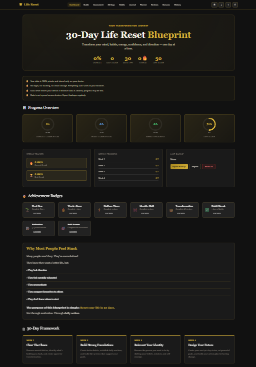

# 30-Day Life Reset Blueprint

An AI-assisted, responsive front-end web application designed to help users organise a 30-day personal development journey, track habits, record reflections, and monitor progress.

## Features

- Interactive dashboard and progress indicators
- 30-day personal development program
- Customisable habit tracker and streak tracking
- Daily reflection journal and journal history
- Daily planner and mood tracking
- Life assessment and progress comparisons
- Dark and light themes
- Local browser data storage
- JSON backup export and import
- Responsive layout for desktop and mobile

## Technologies

- HTML5
- CSS3
- JavaScript
- Browser Local Storage
- HTML Canvas for progress visualisations

## How to Run

1. Download or clone this repository.
2. Open `index.html` in a modern web browser.
3. Use the application and test its interactive features.

## Data and Privacy

The application stores user data locally in the browser. Data is not automatically synchronised across devices. Users should export backups regularly.

## Screenshots

## Project Links

- Live Demo: Add your GitHub Pages URL here
- Source Code: Add your GitHub repository URL here

## Development Note

AI-assisted development was used in creating this project. The implementation should be reviewed and tested before production use.
